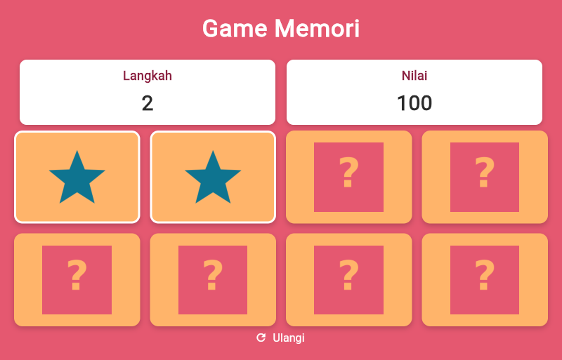

# Game Memori — Flutter

Tugas mata kuliah **Pemrograman Game Mobile** (Sesi 3: Membuat Game Sederhana).

Game memori mencocokkan pasangan gambar. Kartu dari modul praktikum yang semula
**4 buah ditambah menjadi 8 kartu** (4 pasang gambar, tiap gambar muncul dua kali).



## Fitur

- **8 kartu / 4 pasang** gambar: lingkaran, segitiga, kotak, bintang.
- Kartu diacak setiap permainan baru.
- Penghitung **Langkah** dan **Nilai** (100 poin per pasangan).
- Kartu yang salah cocok tertutup kembali otomatis setelah 700 ms.
- Kartu yang sudah terbuka atau sudah cocok tidak bisa ditekan ulang.
- Dialog hasil saat semua pasangan terbuka, plus tombol **Ulangi**.
- Grid adaptif: 2 kolom di ponsel, 4 kolom di layar lebar.

## Teknologi

| Komponen | Versi |
|---|---|
| Flutter | 3.47.9 (stable) |
| Dart | 3.13.7 |
| Target | Android (APK), Linux desktop, Web |

## Struktur proyek

```
lib/
  main.dart          # MyApp + HomeScreen: UI, grid kartu, alur permainan
  images_card.dart   # class Game: daftar gambar, pengacakan, aturan cocok/tidak cocok
  info_card.dart     # widget info_card(): kotak "Langkah" dan "Nilai"
assets/images/       # hidden.png, circle.png, triangle.png, square.png, star.png
test/
  game_logic_test.dart   # unit test aturan permainan
  widget_test.dart       # widget test tampilan + golden
  playthrough_test.dart  # main sampai selesai, cek dialog hasil
```

## Cara menjalankan

```bash
flutter pub get
flutter analyze     # No issues found!
flutter test        # 11 test lulus
flutter run         # ke perangkat / emulator
```

Membangun APK:

```bash
flutter build apk --release
# hasil: build/app/outputs/flutter-apk/app-release.apk
```

APK siap pasang tersedia di halaman **Releases** repositori ini.

## Cara bermain

1. Ketuk satu kartu untuk membukanya.
2. Ketuk kartu kedua. Bila gambarnya sama, kedua kartu tetap terbuka dan nilai
   bertambah 100. Bila beda, kedua kartu tertutup kembali.
3. Selesaikan keempat pasangan. Jumlah langkah dan nilai akhir tampil di dialog.

## Logika permainan (class `Game`)

1. `initGame()` — susun `cardsList` = 4 gambar x 2 lalu `shuffle()`, semua kartu
   ditutup (`hiddenCardPath`), `langkah` dan `nilai` dinolkan.
2. `bisaDibuka(i)` — kartu boleh dibuka bila belum cocok, belum terbuka, dan
   tidak ada dua kartu lain yang sedang menunggu.
3. `buka(i)` — tampilkan gambar asli kartu, tambah `langkah`.
4. `periksa()` — bila dua kartu bergambar sama: tandai `matched`, `nilai += 100`.
   Bila beda: kembalikan `false`.
5. `tutup()` — kartu yang tidak cocok ditutup kembali setelah jeda 700 ms.
6. `selesai` — true bila keempat pasangan sudah terbuka; UI menampilkan dialog hasil.

## Perubahan dibanding modul praktikum

| Aspek | Modul (4 kartu) | Versi ini (8 kartu) |
|---|---|---|
| Jumlah kartu | 4 (2 pasang) | 8 (4 pasang) |
| Gambar | circle, triangle | circle, triangle, square, star |
| Susunan kartu | tetap | diacak tiap permainan |
| Deteksi pasangan | `matchCheck` (List<Map>) | indeks kartu + penanda `matched` |
| Tap kartu berulang | bisa (bug) | dikunci |
| Reset | tidak ada | tombol "Ulangi" |
| Layout | tinggi tetap, mudah overflow | rasio kartu dihitung dari ruang tersedia |

## Lisensi

MIT
